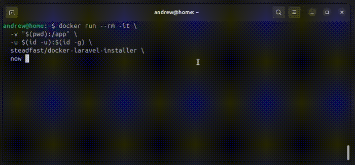

<div align="center">

# Laravel Installer for Docker

   

**Start a new Laravel project with one `docker run`.<br>You need only Docker, and the installer inside is always the latest release.**

A ready-to-use Docker image for the official [Laravel Installer](https://github.com/laravel/installer) that updates itself.

</div>

## Features

- 🔄 **Always up to date.** New Laravel Installer releases are built automatically within 24 hours.
- 🐳 **Only Docker required.** Everything the installer needs is already inside the container.
- 🏗️ **Built on the official Laravel Sail image.**
- 👤 **Files belong to you.** With `-u $(id -u):$(id -g)` the project is owned by your user, not root.
- 📌 **Version tags.** Pin an exact installer version when you need one.
- 🔍 **Transparent.** Every update is a [public commit](https://github.com/Everhard/docker-laravel-installer/commits/main) in this repo.

## Quick start
```bash
docker run --rm -it \
  -v "$(pwd):/app" \
  -u $(id -u):$(id -g) \
  steadfast/docker-laravel-installer \
  new example
```

> [!TIP]
> Replace `example` with the name of the folder where your new Laravel project should be created.
> The folder will be created inside your current working directory.

## Demo


## Tags

| Tag      | Points to                               |
|----------|-----------------------------------------|
| `latest` | The newest Laravel Installer release    |
| `X`      | The newest `X.*.*` release, e.g. `5`    |
| `X.Y`    | The newest `X.Y.*` release, e.g. `5.32` |
| `X.Y.Z`  | One exact release, e.g. `5.32.0`        |

Check which version you have:
```bash
docker run --rm steadfast/docker-laravel-installer --version
```

## How updates work

1. Every day a workflow asks GitHub for the latest `laravel/installer` release.
2. If it is newer than the one in the `Dockerfile`, the workflow commits the new version here.
3. The image is rebuilt and pushed to Docker Hub with all four tags.

## Background

There is no official Docker image that ships the latest version of the Laravel Installer.
The installer gets new releases often, and I kept updating it by hand to stay on the newest one.

So I built this image myself. Now it picks up every new installer release automatically.
